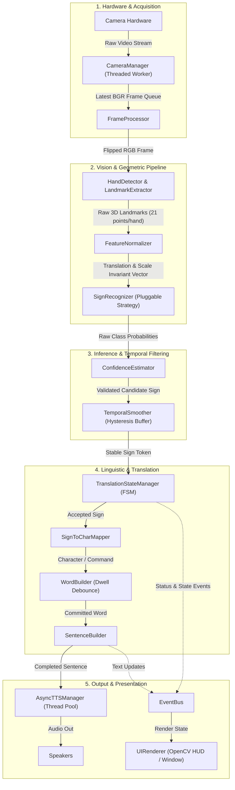

# SignBridge: Software Architecture Specification
**Real-Time Sign Language Recognition & Translation System**

*Author: Senior Computer Vision Architect & Vision Systems Laboratory*  
*Project Stage: Stage 1 — Architectural Design & System Contracts*  
*Target Runtime: Python 3.11.x (Virtual Environment) | OpenCV | MediaPipe*

---

## 1. Architectural Overview & System Topology

SignBridge is architected as an **asynchronous, pipelined, decoupled event-driven system**. Real-time vision systems suffer severe frame-rate degradation and input latency when video capture, heavy feature extraction, ML inference, and text-to-speech are combined in a naive single-threaded loop.

To achieve continuous **30–60 FPS camera throughput** while providing accurate linguistic translation, SignBridge separates execution into five distinct architectural layers:

1. **Hardware & Acquisition Layer**: Threaded video capture isolating hardware IO from processing.
2. **Vision & Geometric Pipeline Layer**: Optical frame preprocessing, MediaPipe landmark extraction, translation/scale-invariant normalization.
3. **Inference & Temporal Filtering Layer**: Pluggable recognizer strategy, confidence thresholding, and temporal hysteresis smoothing.
4. **Linguistic & Translation Layer**: Finite State Machine (FSM), character mapping, dwell-time word buffering, and sentence synthesis.
5. **Output & Presentation Layer**: Non-blocking asynchronous Text-To-Speech (TTS), event bus, and decoupled OpenCV/Web UI renderer.



---

## 2. Detailed Module Specifications

Below is the exhaustive architectural design for each of the 18 core modules.

---

### Module 1: Application Configuration (`signbridge.core.config`)

* **Responsibility**: Provides centralized, type-safe, immutable application configuration using Python dataclasses or Pydantic. Houses hyperparameters for camera capture, vision thresholds, ML models, temporal smoothing windows, and UI themes.
* **Inputs**: `.env` files, optional CLI arguments, or default configuration constants.
* **Outputs**: Strongly-typed `AppConfig` instance (composed of `CameraConfig`, `VisionConfig`, `RecognitionConfig`, `NLPConfig`, `UIConfig`).
* **Dependencies**: Python standard library (`dataclasses`, `pathlib`, `os`).
* **Inter-Module Communication**: Injected into constructors of all service modules during application bootstrap. No module hardcodes magic numbers.

---

### Module 2: Camera Management (`signbridge.camera.capture`)

* **Responsibility**: Manages camera hardware lifecycle (`cv2.VideoCapture`). Executes frame capture inside a dedicated background producer thread to prevent OS video buffer accumulation (which causes latency drift). Automatically detects camera disconnections and measures live FPS.
* **Inputs**: Device index (e.g., `0`), target resolution $(W \times H)$, requested FPS from `CameraConfig`.
* **Outputs**: `FramePacket` object containing timestamp, frame ID, capture latency, and raw numpy array (`ndarray` in BGR format).
* **Dependencies**: `cv2` (OpenCV), `threading`, `queue`, `numpy`.
* **Inter-Module Communication**: Produces frames into a bounded, thread-safe queue (`maxsize=1`, dropping stale frames if pipeline is busy). Consumed by `FrameProcessor`.

---

### Module 3: OpenCV Frame Processing (`signbridge.vision.processor`)

* **Responsibility**: Performs optical frame conditioning and graphics rendering:
  1. Horizontal mirror flipping (for intuitive interactive user feedback).
  2. Color-space conversion (BGR to RGB for MediaPipe inference; RGB back to BGR for OpenCV display).
  3. Aspect-ratio letterboxing or ROI extraction.
  4. Rendering bounding boxes, skeleton wireframes, and heads-up display (HUD) statistics over output frames.
* **Inputs**: Raw BGR frame (`np.ndarray`), visual annotations from recognizer and translation state.
* **Outputs**: Processed RGB frame for inference, annotated BGR frame for UI presentation.
* **Dependencies**: `cv2`, `numpy`.
* **Inter-Module Communication**: Called sequentially by the main vision pipeline loop. Hands RGB frame to `HandDetector`, and passes annotated BGR frame to `UIRenderer`.

---

### Module 4: Hand Detection (`signbridge.vision.detector`)

* **Responsibility**: Wraps palm/hand localization backend (MediaPipe Hands detector). Determines presence, bounding box, and handedness (Left vs. Right) in the current frame.
* **Inputs**: Conditioning RGB image (`np.ndarray`).
* **Outputs**: `HandDetectionResult` container with boolean `is_detected`, bounding box coordinates $(x_{\min}, y_{\min}, x_{\max}, y_{\max})$, and handedness classification (`LEFT`, `RIGHT`, `UNKNOWN`).
* **Dependencies**: `mediapipe`, `numpy`.
* **Inter-Module Communication**: Works directly with Module 5 (`HandLandmarkExtractor`) to produce high-fidelity skeletal topologies.

---

### Module 5: Hand Landmark Extraction (`signbridge.vision.landmarks`)

* **Responsibility**: Extracts 21 precise 3D keypoints per detected hand (wrist, thumb, index, middle, ring, pinky joints).
* **Inputs**: RGB image and detected hand ROI.
* **Outputs**: `LandmarkList` containing 21 `Landmark3D(x, y, z)` points with normalized screen coordinates and metric depth estimates.
* **Dependencies**: `mediapipe`, `numpy`.
* **Inter-Module Communication**: Passes raw landmark lists to Module 6 (`FeatureNormalizer`).

---

### Module 6: Feature Normalization (`signbridge.features.normalizer`)

* **Responsibility**: Transforms raw hand coordinates into a **translation-invariant, scale-invariant, and rotation-stabilized feature vector**. Without normalization, a sign performed close to the camera or in the corner of the frame produces vastly different numbers than one performed at center-distance.
  1. **Translation Invariance**: Subtraction of wrist coordinate $(x_0, y_0, z_0)$ from all 20 other keypoints.
  2. **Scale Invariance**: Normalization by palm reference distance (Euclidean distance between wrist `0` and MCP base `9`).
  3. **Feature Flattening**: Converts 3D coordinates into a 1D feature vector of dimension $63$ (or $42$ if 2D) plus optional joint angles (calculated via vector dot products).
* **Inputs**: `LandmarkList` (raw 21 points).
* **Outputs**: `NormalizedFeatureVector` (`np.ndarray` of shape `(D,)`, normalized to $[-1.0, 1.0]$).
* **Dependencies**: `numpy`, `math`.
* **Inter-Module Communication**: Feeds invariant numerical vector directly into Module 7 (`SignRecognizer`).

---

### Module 7: Sign Recognition (`signbridge.recognition.base`)

* **Responsibility**: Implements the **Strategy Design Pattern** (`ISignRecognizer`). Evaluates the normalized feature vector (or temporal sequence of vectors) and computes class scores across the sign vocabulary.
  - *Extensibility*: Allows hot-swapping between Heuristic Rule-Based, K-Nearest Neighbors, Random Forest, PyTorch MLP, or Temporal LSTM/Transformer models without altering any upstream capture or downstream NLP modules.
* **Inputs**: `NormalizedFeatureVector` (static) or window buffer `SequenceFeatureTensor` (dynamic).
* **Outputs**: `RawInferenceResult` containing predicted class label ID, raw logits/probability distribution array across all vocabulary tokens.
* **Dependencies**: Abstract interface depending only on `numpy`. Concrete model implementations depend on `scikit-learn`, `torch`, or `onnxruntime`.
* **Inter-Module Communication**: Invoked by vision pipeline coordinator; sends inference output to Module 8 (`ConfidenceEstimator`).

---

### Module 8: Confidence Estimation (`signbridge.recognition.confidence`)

* **Responsibility**: Evaluates the certainty of the model's prediction.
  1. Applies Softmax temperature scaling to raw logits.
  2. Evaluates margin between top-1 and top-2 candidates (identifying ambiguous hand shapes).
  3. Discards predictions below `confidence_threshold` (e.g., $0.75$) or transitions where the hand is in an undefined/resting position.
* **Inputs**: `RawInferenceResult`.
* **Outputs**: `ScoredPrediction(label: str, confidence: float, is_valid: bool)`.
* **Dependencies**: `numpy`.
* **Inter-Module Communication**: Passes validated predictions to Module 9 (`TemporalSmoother`). Rejection signals notify Module 13 (`TranslationStateManager`) to enter `IDLE` or `REST` state.

---

### Module 9: Temporal Smoothing (`signbridge.temporal.smoother`)

* **Responsibility**: Suppresses high-frequency classification jitter and transition artifacts (co-articulation noise between signs). Implements:
  1. **Sliding Window Majority Voting**: Maintains a rolling buffer of size $K$ (e.g., 7–10 frames).
  2. **Hysteresis Thresholding**: Requires a new sign to achieve at least $M$-of-$N$ consensus before switching the recognized sign state.
* **Inputs**: Stream of per-frame `ScoredPrediction`.
* **Outputs**: `StabilizedSign(label: str, consensus_ratio: float, duration_frames: int)`.
* **Dependencies**: Python standard library (`collections.deque`), `numpy`.
* **Inter-Module Communication**: Delivers stable, de-noised sign events to Module 10 (`SignToCharMapper`) and Module 13 (`TranslationStateManager`).

---

### Module 10: Sign-to-Character / Command Mapping (`signbridge.nlp.mapping`)

* **Responsibility**: Maps recognized raw sign tokens (e.g., `"SIGN_A"`, `"SIGN_SPACE"`, `"SIGN_DEL"`) into linguistic semantic tokens (characters, numerals, control commands).
* **Inputs**: `StabilizedSign`.
* **Outputs**: `LinguisticToken(token_type: TokenType, value: str)` (e.g., `CHAR('H')`, `COMMAND('BACKSPACE')`, `COMMAND('SPACE')`, `WORD('HELLO')`).
* **Dependencies**: Standard library (`enum`, `dataclasses`).
* **Inter-Module Communication**: Emits parsed tokens to Module 11 (`WordBuilder`).

---

### Module 11: Word Formation (`signbridge.nlp.word_builder`)

* **Responsibility**: Implements dwell-time character accumulation and editing logic:
  1. **Dwell Debouncing**: Requires a sign to be held stably for a minimum threshold (e.g., 400ms) before committing a character, preventing accidental character duplication.
  2. **Character Accumulation**: Buffers characters into an active word.
  3. **Editing Commands**: Handles backspace (erasing last character) or clear buffer commands.
  4. **Word Delimitation**: Commits active word upon receiving a space token or prolonged hand-down gesture.
* **Inputs**: `LinguisticToken` stream with millisecond timestamps.
* **Outputs**: `WordEvent(current_partial_word: str, committed_word: Optional[str])`.
* **Dependencies**: Standard library (`time`, `typing`).
* **Inter-Module Communication**: Sends partial word updates to UI Event Bus; sends `committed_word` to Module 12 (`SentenceBuilder`).

---

### Module 12: Sentence Formation (`signbridge.nlp.sentence_builder`)

* **Responsibility**: Assembles sequences of committed words into grammatically correct sentences:
  1. Space insertion and trailing whitespace cleanup.
  2. Auto-capitalization of initial sentence characters.
  3. Punctuation insertion (full stops, question marks based on gesture tokens or silence timeouts).
  4. Complete sentence dispatch for speech synthesis.
* **Inputs**: `committed_word: str` or punctuation events.
* **Outputs**: `SentenceState(current_sentence: str, last_completed_sentence: Optional[str])`.
* **Dependencies**: Standard library (`re`, `typing`).
* **Inter-Module Communication**: Notifies Module 14 (`TextToSpeech`) when a sentence is finalized; publishes state changes to Module 15 (`UICommunication`).

---

### Module 13: Translation State Management (`signbridge.state.fsm`)

* **Responsibility**: Oversees the holistic operational state of the translation engine using a **Finite State Machine (FSM)**:
  - `NO_HAND`: Camera active, but no hands in frame. System idle.
  - `TRACKING`: Hand detected; computing landmarks and features.
  - `SIGNING`: Active sign recognized with high confidence; dwell timer accumulating.
  - `COARTICULATION`: Hand moving between two deliberate signs.
  - `COMMITTED`: Sign/character accepted; waiting for hand to shift or reset.
  - `PAUSED`: User triggered pause gesture or UI button.
* **Inputs**: Landmark visibility flags, stabilized sign predictions, UI control commands.
* **Outputs**: Current `SystemState`, state transition events with telemetry timestamps.
* **Dependencies**: Standard library (`enum`, `dataclasses`).
* **Inter-Module Communication**: Coordinates behavior across vision, NLP, and UI modules, ensuring no characters are typed during transition phases.

---

### Module 14: Text-To-Speech (TTS) (`signbridge.audio.tts`)

* **Responsibility**: Synthesizes spoken audio from finalized words or sentences. Runs speech playback in a detached worker thread or non-blocking process pool to ensure OpenCV video rendering never freezes during voice output.
* **Inputs**: Finalized sentence or word string (`str`), voice volume/rate preferences.
* **Outputs**: Audio waveform to system speakers; completion callback event.
* **Dependencies**: Abstract `ITextToSpeech` interface. Concrete backends: `pyttsx3` (offline, multi-platform) or OS speech API.
* **Inter-Module Communication**: Triggered by `SentenceBuilder` upon sentence termination or manual "Speak" command.

---

### Module 15: UI Communication & Event Bus (`signbridge.ui.events`)

* **Responsibility**: Decouples backend domain services from the presentation layer using a publish-subscribe **EventBus** pattern:
  - Events: `FrameEvent`, `LandmarkEvent`, `PredictionEvent`, `WordUpdatedEvent`, `SentenceCompletedEvent`, `StateChangedEvent`.
* **Inputs**: Events published by any system component.
* **Outputs**: Dispatched calls to subscribed listeners (UI HUD renderer, logging monitors, external web sockets).
* **Dependencies**: Standard library (`typing`, `callable`, `threading`).
* **Inter-Module Communication**: Acts as the central nervous system connecting computational logic to presentation without direct cyclic dependencies.

---

### Module 16: Error Handling (`signbridge.core.exceptions`)

* **Responsibility**: Defines a comprehensive, semantic exception hierarchy for runtime failures, ensuring errors are categorized, reported cleanly to the user, and handled gracefully without crashing the application.
  - `SignBridgeError` (Base)
    - `CameraError` (Camera initialization failure, frame dropped, device disconnected)
    - `VisionPipelineError` (Landmark extraction failure, dimension mismatch)
    - `ModelError` (Missing weights file, invalid tensor shape, unsupported architecture)
    - `AudioError` (TTS engine initialization failure)
    - `ConfigurationError` (Invalid or missing settings)
* **Inputs**: Exceptions raised across modules.
* **Outputs**: Handled fallback procedures, user-friendly UI error banners, and diagnostic tracebacks.
* **Dependencies**: Standard library.
* **Inter-Module Communication**: Caught at subsystem boundaries and logged via `SignBridgeLogger`.

---

### Module 17: Logging Subsystem (`signbridge.core.logger`)

* **Responsibility**: Standardized, configurable structured logging. Provides dual output:
  1. ANSI color-coded console logs for development.
  2. Rotating file logger (`logs/signbridge.log`) with ISO-8601 timestamps, module names, line numbers, and error traces.
* **Inputs**: Log messages with severity levels (`DEBUG`, `INFO`, `WARNING`, `ERROR`, `CRITICAL`).
* **Outputs**: Formatted console stream and persistent log files.
* **Dependencies**: Standard library (`logging`, `logging.handlers`, `pathlib`).
* **Inter-Module Communication**: Instantiated and used across all modules.

---

### Module 18: Testing & Verification Harness (`tests/`)

* **Responsibility**: Comprehensive testing infrastructure ensuring modular correctness and regression prevention:
  1. **Unit Tests**:
     - Synthetic landmark arrays to verify feature normalizer mathematical correctness (translation/scale invariance).
     - Dwell-time debouncing and state machine transitions.
     - Word and sentence assembly formatting.
  2. **Mock Recognizers**:
     - Deterministic mock recognizers implementing `ISignRecognizer` for testing the entire pipeline end-to-end without real cameras or trained ML models.
* **Inputs**: Test fixtures, synthetic coordinate data, mock events.
* **Outputs**: Pytest assertions and test coverage reports.
* **Dependencies**: `pytest`, `numpy`.
* **Inter-Module Communication**: Tests each module in strict isolation using mocked boundaries.

---

## 3. Class Contracts & Core Abstract Interfaces

To guarantee that the recognition model, camera source, and audio backends can be swapped without modifying the application pipeline, SignBridge defines strict abstract base classes (`abc.ABC`):

### A. Camera Source Contract (`ICameraSource`)
```python
from abc import ABC, abstractmethod
from typing import Optional
import numpy as np

class ICameraSource(ABC):
    @abstractmethod
    def start(self) -> None:
        """Start acquisition thread."""
        pass

    @abstractmethod
    def read(self) -> tuple[bool, Optional[np.ndarray]]:
        """Retrieve the most recent frame."""
        pass

    @abstractmethod
    def stop(self) -> None:
        """Release camera hardware."""
        pass
```

### B. Sign Recognizer Strategy Contract (`ISignRecognizer`)
```python
from abc import ABC, abstractmethod
import numpy as np
from signbridge.recognition.confidence import ScoredPrediction

class ISignRecognizer(ABC):
    @abstractmethod
    def load(self, model_path: str) -> None:
        """Load model weights, config, and vocabulary mappings."""
        pass

    @abstractmethod
    def predict(self, feature_vector: np.ndarray) -> ScoredPrediction:
        """Predict sign label and confidence score from a normalized feature vector."""
        pass

    @property
    @abstractmethod
    def vocabulary(self) -> list[str]:
        """Return list of supported sign tokens."""
        pass
```

### C. Text-To-Speech Contract (`ITextToSpeech`)
```python
from abc import ABC, abstractmethod

class ITextToSpeech(ABC):
    @abstractmethod
    def speak(self, text: str, non_blocking: bool = True) -> None:
        """Synthesize and vocalize text without blocking video processing."""
        pass

    @abstractmethod
    def stop(self) -> None:
        """Immediately interrupt ongoing speech."""
        pass
```

---

## 4. Architectural Summary

| Requirement | Architectural Solution |
|---|---|
| **Zero Frame Drops** | Producer-consumer camera threading with bounded frame queues |
| **User/Distance Invariance** | Geometric feature normalization (wrist-origin centering + palm-scale division) |
| **Jitter-Free Predictions** | Temporal rolling window with hysteresis thresholding |
| **Pluggable ML Models** | Strategy Pattern via `ISignRecognizer` interface |
| **Decoupled UI & Presentation** | Publish-Subscribe EventBus |
| **Maintainability & College Demonstration** | Clean layered package hierarchy with strict separation of concerns |
